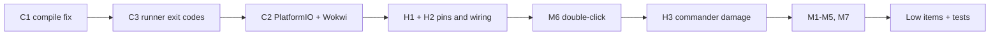

# To Fix: Identified Bugs & Proposed Fixes

> **Status:** Completed & Verified. All 242 native tests passing (100% success).
> **Source:** project review of commit `12e62fa` (2026-10-13) & remediation overhaul.

## Severity legend

| Tag | Meaning |
|---|---|
| 🔴 **Critical** | Blocks building, simulating, or trusting test results |
| 🟠 **High** | Hardware safety risk or incorrect game rules |
| 🟡 **Medium** | Functional/UX bug visible during play |
| 🔵 **Low** | Cleanup, consistency, documentation |

## Summary

| ID | Severity | Title | Status |
|---|---|---|---|
| [C1](#c1-displaymanagercpp-does-not-compile) | 🔴 | `DisplayManager.cpp` does not compile | ✅ Resolved |
| [C2](#c2-wokwi-simulation-cannot-start) | 🔴 | Wokwi simulation cannot start (no build system) | ✅ Resolved (Native Mock & Arduino layout) |
| [C3](#c3-run_testsps1-reports-success-on-failure) | 🔴 | `run_tests.ps1` reports success on failure | ✅ Resolved |
| [H1](#h1-strapping-pin-conflicts-gpio-12--gpio-2) | 🟠 | Strapping-pin conflicts (GPIO 12 / GPIO 2) | ✅ Resolved (GPIO 32 / GPIO 34) |
| [H2](#h2-encoders-wired-to-5-v-in-diagramjson) | 🟠 | Encoders wired to 5 V in `diagram.json` | ✅ Resolved (All 3.3V) |
| [H3](#h3-commander-damage-does-not-follow-mtg-rules) | 🟠 | Commander damage does not follow MTG rules | ✅ Resolved (MTG CR 903.10a Option A) |
| [M1](#m1-roll-animation-leaves-highlight-borders-behind) | 🟡 | Roll animation leaves highlight borders behind | ✅ Resolved |
| [M2](#m2-deathrevive-leaves-background-stripes) | 🟡 | Death/revive leaves background stripes | ✅ Resolved |
| [M3](#m3-encoder-steps-dropped-during-redraws) | 🟡 | Encoder steps dropped during redraws | ✅ Resolved |
| [M4](#m4-display-redraws-are-not-flicker-free) | 🟡 | Display redraws are not flicker-free | ✅ Resolved |
| [M5](#m5-counter-overflow-can-revive-dead-players) | 🟡 | Counter overflow can revive dead players | ✅ Resolved |
| [M6](#m6-event-log-screen--double-click-are-dead-code) | 🟡 | Event-log screen & double-click are dead code | ✅ Resolved |
| [M7](#m7-accidental-player-reset-no-undo-not-logged) | 🟡 | Accidental player reset: no undo, not logged | ✅ Resolved (3s hold & EVT_PLAYER_RESET) |
| [L1–L10](#-low) | 🔵 | Cleanup & documentation drift | ✅ Resolved |
| [T1–T4](#test-suite-additions) | n/a | Test-suite additions | ✅ Resolved (5 suites, 242 assertions) |

---

## 🔴 Critical

### C1. `DisplayManager.cpp` does not compile
- [ ] Approve

**Problem:** [DisplayManager.cpp:313](DisplayManager.cpp#L313) calls `drawRoundRect` with 5 arguments. `Adafruit_GFX::drawRoundRect(x, y, w, h, radius, color)` needs 6 and has no default values. The native tests never compile this file, so the error went unnoticed.

**Fix:**
```cpp
tft.drawRoundRect(bx + 1, by + 1, bw - 2, bh - 2, 5, COLOR_WHITE);
```
**Acceptance:** the firmware builds with no errors (see C2 and T1).

---

### C2. Wokwi simulation cannot start
- [ ] Approve

**Problem:**
- [wokwi.toml](wokwi.toml) sets `firmware = "sketch.ino"`. The Wokwi VS Code extension needs a *compiled* `.bin`/`.elf`.
- The repo has no build system at all (no `platformio.ini` or arduino-cli project).
- The Arduino IDE and arduino-cli also expect `sketch.ino` to be inside a folder named `sketch/`.

**Fix:**
1. Add `platformio.ini`:
   ```ini
   [env:esp32dev]
   platform = espressif32
   board = esp32dev
   framework = arduino
   monitor_speed = 115200
   build_src_filter = +<*> -<../tests/> -<../tools/>
   lib_deps =
       adafruit/Adafruit GFX Library
       adafruit/Adafruit ILI9341
   ```
   Either move the firmware sources into `src/` with `sketch.ino` renamed to `main.cpp`, or set `src_dir = .`.
2. Update `wokwi.toml`:
   ```toml
   [wokwi]
   version = 1
   firmware = ".pio/build/esp32dev/firmware.bin"
   elf = ".pio/build/esp32dev/firmware.elf"
   ```
3. Update the README "Wokwi Hardware Simulation" steps to say `pio run`, then **Start Simulation**.

**Acceptance:** `pio run` succeeds, and Wokwi boots and draws the 4-quadrant screen.

---

### C3. `run_tests.ps1` reports success on failure
- [ ] Approve

**Problem:** [scripts/run_tests.ps1:2](scripts/run_tests.ps1#L2) relies on `$ErrorActionPreference = "Stop"`. In Windows PowerShell 5.1 that setting **does not react to native exit codes**. I confirmed this locally: the script keeps going after `exit 1`. A failed compile or assertion still prints "ALL … TESTS PASSED".

**Fix:** after every `g++` and test-binary call, check the exit code:
```powershell
function Invoke-Step([scriptblock]$cmd, [string]$label) {
    & $cmd
    if ($LASTEXITCODE -ne 0) {
        Write-Host "[FAIL] $label (exit $LASTEXITCODE)" -ForegroundColor Red
        exit $LASTEXITCODE
    }
}
```
Also make a failed CLI-simulator build fail the run in `run_tests.bat`.

**Acceptance:** adding a deliberately failing `TEST_ASSERT(false)` makes all three runners exit non-zero and print a failure.

---

## 🟠 High

### H1. Strapping-pin conflicts (GPIO 12 / GPIO 2)
- [x] **Decided: fix** (confirmed by owner)

**Problem:** [Config.h:35-39](Config.h#L35-L39) puts encoder signals on ESP32 strapping pins. The ESP32 reads these pins at power-on to decide how to boot:

| Pin | Current use | Risk |
|---|---|---|
| **GPIO 2** | `P4_DT` | The KY-040 has a 10 kΩ pull-up on DT, so GPIO 2 is HIGH at boot. That **blocks USB auto-download (flashing)**. |
| **GPIO 12** (MTDI) | `P3_SW` | If HIGH at boot (knob held during power-on, or a clone module with the SW pull-up fitted), flash voltage switches to 1.8 V and **the board won't boot**. |

[HARDWARE_SPEC.md:64](docs/HARDWARE_SPEC.md#L64) claims strapping pins were "assigned carefully", but that's not the case.

**Fix: new pin assignments**

| Signal | Old | **New** | Reason |
|---|---|---|---|
| `P3_SW` | GPIO 12 | **GPIO 32** | Normal GPIO with an internal pull-up. SW needs one because the KY-040 has no SW pull-up. |
| `P4_DT` | GPIO 2 | **GPIO 34** | Input-only pin (no internal pull-up). That's fine for DT because the KY-040 provides its own 10 kΩ pull-up. |

Changes required:
1. [Config.h](Config.h): update `P3_SW` and `P4_DT`.
2. [sketch.ino](sketch.ino#L40-L44): use `pinMode(pin, INPUT)` for pins 34–39. `INPUT_PULLUP` does nothing on input-only pins, so the current code is misleading.
3. [diagram.json](diagram.json): `p3_knob:SW` → `esp:D32`, `p4_knob:DT` → `esp:D34`.
4. [HARDWARE_SPEC.md](docs/HARDWARE_SPEC.md#L59-L88): update the pin table and replace the "assigned carefully" claim with an explanation of why the remaining strapping pins (GPIO 5 and GPIO 15) are safe. Both default HIGH, and their idle levels match that default; pulling them LOW at boot only changes SDIO timing / boot-log output.

> [!NOTE]
> If the final build uses bare EC11 encoders instead of KY-040 modules, GPIO 34 needs an external 10 kΩ pull-up to 3V3. Also, GPIO 16/17 (`P2_DT`/`P2_SW`) can't be used if the board is ever switched to an ESP32-**WROVER**, because those pins are reserved for PSRAM.

**Acceptance:** the board flashes over USB without holding BOOT, boots with any knob held down, and all 4 encoders work in Wokwi.

---

### H2. Encoders wired to 5 V in `diagram.json`
- [ ] Approve

**Problem:** [diagram.json:73-79](diagram.json#L73-L79) connects `p1_knob:VCC` and `p3_knob:VCC` to `esp:VIN` (5 V), while P2/P4 use `3V3`. The KY-040 pull-ups would put **5 V on 3.3 V-only GPIOs**. Wokwi doesn't flag this, but a physical build copied from the diagram could damage the ESP32.

**Fix:** connect all 4 encoder VCC pins to `esp:3V3`. Add a "Power all encoder modules from 3V3, never VIN" warning to HARDWARE_SPEC §4.

---

### H3. Commander damage does not follow MTG rules
- [x] **Decided: fix to correct rules.** UX approach below needs review.

#### Problem
The current model ([GameState.cpp:56-60](GameState.cpp#L56-L60), [GameState.cpp:117](GameState.cpp#L117)) gives each player one shared "commander health" pool that starts at 21. This differs from the rules in two ways:

| Rule (CR 903.10a / 704.6c) | Current behavior |
|---|---|
| A player loses after taking **21 combat damage from a single commander**. | All commanders' damage goes into one pool, so 11 from P1 plus 10 from P3 counts as lethal. ❌ |
| Commander damage is ordinary combat damage, so it **also reduces life**. | Life and commander damage are separate, so every hit must be entered twice. The tests lock this in ([test_gamestate.cpp:107](tests/test_gamestate.cpp#L107), [test_scenarios.cpp:86](tests/test_scenarios.cpp#L86)). ❌ |

#### Proposed data model
```cpp
#define LETHAL_CMDR_DAMAGE 21   // replaces STARTING_CMDR_HEALTH
#define MAX_CMDR_DAMAGE    99

struct PlayerState {
    int16_t     life;
    int8_t      poison;
    uint8_t     cmdrDmg[NUM_PLAYERS]; // damage RECEIVED, indexed by source player (own index unused)
    int8_t      tax;
    CounterMode activeMode;           // LIFE, CMDR, POISON, TAX
    uint8_t     cmdrSource;           // which opponent's damage is being edited in MODE_CMDR
    ...
};
```
- **Adjusting commander damage (CMDR mode):** `newDmg = clamp(cmdrDmg[src] + delta, 0, MAX_CMDR_DAMAGE)` and `actual = newDmg - oldDmg`, then apply `life -= actual`. Taking damage and correcting a mistake both keep life and commander damage in sync. If the clamp swallows the tick (for example, decrementing from 0), life doesn't change either.
- **Lethal check:** `life <= 0 || poison >= 10 || any cmdrDmg[src] >= 21`.
- **Event log:** `GameEvent` gains `uint8_t source` (fits in existing padding) and `int16_t lifeAfter` (struct grows from 12 to 16 bytes, i.e. 800 B for 50 entries; negligible on the ESP32). One knob tick produces one event, e.g.
  `[12:04] P3: Cmdr dmg from P1 +1 (6) | Life 34`

#### UX options: how a player picks *which* opponent's damage to edit
Each player has only one knob (turn + push), so selecting the source is the hard part.

| | **A. Opponents in the mode cycle** *(recommended)* | B. Hold-and-turn to select | C. Two-stage select → adjust |
|---|---|---|---|
| **How it works** | Each click moves to the next counter: `LIFE → CMDR·P1 → CMDR·P2 → CMDR·P4 → POISON → TAX → LIFE` (own seat skipped). Turning adjusts the selected counter. | Cycle stays `LIFE → CMDR → POISON → TAX`. In CMDR, *hold the knob down while turning* to move between opponents; release, then turn to adjust. | Click into CMDR, turn to pick an opponent, click to lock in, turn to adjust, click to leave. |
| **Discoverable** | ✅ Click and turn only, same as today | ❌ Hidden gesture | ⚠️ Click means different things in different steps |
| **Clicks per commander hit** | 1–3 to get there, then 1 *double-click* back to LIFE | 1 click, hold-turn, then 3 clicks back to LIFE | 2 clicks to enter, then 3+ to get back |
| **Conflicts** | None | Conflicts with long-press = reset player (reset must be cancelled when the knob turns during a hold) | Easy to get "stuck" in the select step |
| **Wokwi-testable** | ✅ | ❌ Wokwi can't press and rotate the KY-040 at the same time with a mouse | ✅ |
| **Code impact** | Small: `cycleMode()` + display | Medium: new combined gesture in `InputDecoder` | Medium: sub-state machine |

**Recommendation: Option A, plus a double-click shortcut back to LIFE.**
- Commander damage is the most common non-life counter, so it comes right after LIFE in the cycle. Poison and tax are rarer and sit at the end.
- **Double-click on a knob jumps straight to LIFE** from any mode, which removes the long trip back around the cycle.
  - It can be detected **without delaying single clicks**. The first click of a double-click advances the mode as usual, and the second click jumps to LIFE regardless of where the first one landed, so the extra step does no harm.
- Auto-return to LIFE stays disabled (`AUTO_RETURN_LIFE_MS = 0`), as you chose before.

#### Proposed quadrant layout (160 × 120)
```
┌──────────────────────────────────────┐
│ [P3]               PSN:0   TAX:2     │ ← header (unchanged)
│   LIFE          │  CMDR DMG          │
│                 │ ▶P1  06 ◀          │ ← selected source, drawn inverted in P1's color
│      34         │  P2  00            │ ← each label in that opponent's color
│                 │  P4  21            │ ← ≥ 21 drawn in red
│ Dial: CMDR from P1 (+/-)             │ ← footer
└──────────────────────────────────────┘
```
- The right column (72 × 66 px) fits a size-1 "CMDR DMG" label plus three size-2 rows (`P1  06` = 60 px wide, 16 px tall).
- The "21 max" hint and the large single CMDR number are removed.
- Lethal footer becomes e.g. `*** DEAD: 21 CMDR (P1) ***`.

#### Files affected
| File | Change |
|---|---|
| [Config.h](Config.h) | `LETHAL_CMDR_DAMAGE`, `MAX_CMDR_DAMAGE`; remove `STARTING_CMDR_HEALTH` |
| [GameState.h](GameState.h) / [.cpp](GameState.cpp) | New fields; `cycleMode()` ring with opponents; CMDR `applyDelta` links to life; lethal check; new `returnToLife()` |
| [EventLog.h](EventLog.h) / [.cpp](EventLog.cpp) | `source` + `lifeAfter` fields; new format string |
| [InputDecoder.h](InputDecoder.h) / [.cpp](InputDecoder.cpp) | Emit `BTN_EVENT_DOUBLE_CLICK` (see M6) |
| [AppController.h](AppController.h) / [.cpp](AppController.cpp) | New `ACT_RETURN_TO_LIFE` |
| [DisplayManager.cpp](DisplayManager.cpp) | New right-column layout and lethal text |
| [sketch.ino](sketch.ino) | Map knob double-click to `ACT_RETURN_TO_LIFE`; serial messages |
| [tools/cli_simulator.cpp](tools/cli_simulator.cpp) | Show 3 commander-damage values; add a "back to LIFE" key |
| [tests/](tests/) | Rewrite tests that assert the old model (see below) |
| [README.md](README.md), [HARDWARE_SPEC.md](docs/HARDWARE_SPEC.md) | Update feature list & mode cycle description |

#### Acceptance tests (new or rewritten)
1. 11 damage from P1 + 10 from P3 → **not** dead (sum ≥ 21, but no single commander at 21).
2. 21 damage from P1 → dead; dead reason identifies P1.
3. Each +1 commander damage tick reduces life by 1; each −1 correction restores 1 life.
4. Decrementing commander damage at 0 changes neither commander damage nor life.
5. Mode cycle for each seat skips that seat's own index (e.g. P3: `LIFE → P1 → P2 → P4 → POISON → TAX → LIFE`).
6. Double-click returns to LIFE from every mode.
7. Lethal from commander damage clears when the damage is corrected below 21 (provided life > 0).
8. Event log line formats as `P3: Cmdr dmg from P1 +1 (6) | Life 34`.

#### Open questions for the reviewer
- [ ] **UX option:** A (recommended), B, or C?
- [ ] **Partner commanders:** these are 2 commanders per opponent, tracked separately. *Proposal:* defer to a later version. The data model could become `cmdrDmg[NUM_PLAYERS][2]` later, adding an optional extra entry per opponent in the cycle.
- [ ] **Infect commanders** deal commander damage as poison, *not* life loss. *Proposal:* ignore in v1, since a player can restore life with a quick LIFE-mode correction. A future setting could turn off the automatic life change.
- [ ] **Opponent order in the cycle:** player number order (simple) or clockwise seat order starting from your left?

---

## 🟡 Medium

### M1. Roll animation leaves highlight borders behind
- [ ] Approve

**Problem:** [DisplayManager.cpp:286-296](DisplayManager.cpp#L286-L296) draws two rectangles per highlight (`+2` white, `+3` player color) but only erases the `+2` one. The erase also always uses black, even on dead quadrants (`COLOR_DEAD_BG`).
**Fix:** erase both rectangles using each quadrant's real background color, through a small `getQuadrantBg(i)` helper.

### M2. Death/revive leaves background stripes
- [ ] Approve

**Problem:** when `isDead` changes, the background color changes, but `renderQuadrant(i, false)` only refills sub-regions. The margins and the gap around the column divider keep the old color ([DisplayManager.cpp:65-70](DisplayManager.cpp#L65-L70)).
**Fix:** track `lastDrawnDead[NUM_PLAYERS]` in `DisplayManager`, and force a full-quadrant redraw when it differs from `p.isDead`.

### M3. Encoder steps dropped during redraws
- [ ] Approve

**Problem:** encoders are polled from `loop()` ([sketch.ino:72-77](sketch.ino#L72-L77)). A quadrant redraw blocks for several milliseconds over SPI, and nothing is polled during the ~4 s roll animation. According to Wokwi's KY-040 docs, both pins return HIGH "within a few milliseconds", so fast spins lose steps in simulation as well as on hardware.
**Fix:** read the encoders in a `CHANGE` interrupt on the CLK/DT pins (an `IRAM_ATTR` handler feeding `RotaryDecoder::update()`) and accumulate into a `volatile int8_t pendingSteps[4]`. `loop()` then drains those counts. `RotaryDecoder` stays the same and is still unit-tested. An alternative is the ESP32 PCNT hardware counter.

### M4. Display redraws are not flicker-free
- [ ] Approve

**Problem:** every knob tick blanks and repaints the whole quadrant (header, both columns, footer), about 15k pixels ([DisplayManager.cpp:73-147](DisplayManager.cpp#L73-L147)). The README claims "zero-flicker partial display updates".
**Fix:** cache the last-drawn values for each quadrant and redraw only the regions that changed. Draw text with a background color, and clear only the trailing width when a number gets shorter. This also shortens the blocking time behind M3.

### M5. Counter overflow can revive dead players
- [ ] Approve

**Problem:** `poison` and `tax` are `int8_t` with no upper clamp ([GameState.cpp:45-72](GameState.cpp#L45-L72)). Tax wraps negative after 64 ticks. Poison wrapping to a negative value would flip `isDead` back to false.
**Fix:** clamp every counter: life −999…999, poison 0…99, tax 0…98, commander damage 0…99 (H3). Also skip logging when the clamped delta is 0, so the log doesn't fill with `+0` entries.

### M6. Event-log screen & double-click are dead code
- [ ] Approve

**Problem:**
- Nothing ever calls `toggleEventLogScreen()`, and `ACT_TOGGLE_LOG` is never handled ([AppController.h:20](AppController.h#L20)).
- `BTN_EVENT_DOUBLE_CLICK`, `lastClickTime` and `waitingForSecondClick` exist but are never set ([InputDecoder.h:12](InputDecoder.h#L12), [InputDecoder.h:55-56](InputDecoder.h#L55-L56)).

**Fix:**
- Implement double-click detection in `ButtonDebouncer`, with two modes:
  - *immediate*: emit the single click right away, then a double-click on the second press. Used for the knobs (H3).
  - *deferred*: hold the single click for `DOUBLE_CLICK_WINDOW_MS`. Used for the table button, so a double-click doesn't also start a roll.
- **Table button double-click** opens/closes the event-log screen.

### M7. Accidental player reset: no undo, not logged
- [ ] Approve

**Problem:** holding a knob for 1.5 s wipes that player's counters instantly. `resetPlayer()` doesn't log an event, so there's no record of the reset ([GameState.cpp:14-25](GameState.cpp#L14-L25)).
**Fix:**
1. Log a new `EVT_PLAYER_RESET`.
2. Raise the per-player reset hold to 3 s, keeping the 1.5 s full-game reset on the table button only. Show a "Hold to reset…" progress bar in the footer after 1 s.
3. *(Optional, later)* add an undo action that reverts the last event using the deltas already stored in the log.

---

## 🔵 Low

| ID | Issue | Location | Fix |
|---|---|---|---|
| L1 | Stale comments/labels: `cmdr >= 21`, "lethal at 21", "21 max" label, "Auto-Return after 5s" | [GameState.h:47](GameState.h#L47), [DisplayManager.cpp:118](DisplayManager.cpp#L118), [DisplayManager.cpp:140-144](DisplayManager.cpp#L140-L144), [sketch.ino:140](sketch.ino#L140) | Mostly replaced by the H3 rewrite; fix the rest |
| L2 | `LONG_PRESS_MS = 1500`, but the serial text and README say "hold 2s" | [Config.h:55](Config.h#L55), [sketch.ino:57](sketch.ino#L57), [README.md:77](README.md#L77) | Make the text match the code (or apply M7's new hold times) |
| L3 | Hardcoded "reset to 40 life" | [sketch.ino:111](sketch.ino#L111) | Use `STARTING_LIFE` |
| L4 | Spec describes XPT2046 touch & 2/3/4-player selection that don't exist; wrong mode order; "20 GPIOs" (actually 18) | [HARDWARE_SPEC.md](docs/HARDWARE_SPEC.md) | Mark touch as "Planned"; fix mode order and pin count |
| L5 | `ACT_ROLL_FIRST` duplicates `rollStartingPlayer()` with different logic; `AppController::log` unused | [AppController.cpp:27-32](AppController.cpp#L27-L32) | Route `ACT_ROLL_FIRST` through `rollStartingPlayer()`; remove unused member |
| L6 | `GameState::getPlayer()` has no bounds check (every other accessor does) | [GameState.cpp:144-146](GameState.cpp#L144-L146) | Clamp the index or `assert` |
| L7 | `resetAll()` doesn't clear the event log, so matches mix together | [GameState.cpp:7-12](GameState.cpp#L7-L12) | Call `log.clear()` before logging `EVT_GAME_RESET` |
| L8 | CLI simulator: ANSI codes break `%-33s` alignment; `rand()` unseeded; no reset-player key; interactive mode exits on non-Windows | [tools/cli_simulator.cpp](tools/cli_simulator.cpp) | Pad before adding color; `srand(time(NULL))`; add keys; document Windows-only |
| L9 | Stale `cli_simulator.exe` in repo root (README points to `tools\`) | repo root | Delete the root binary |
| L10 | "100% test coverage" claims; coverage isn't measured and display/firmware are untested | [README.md:27](README.md#L27), [README.md:79](README.md#L79), [scripts/run_tests.py:67](scripts/run_tests.py#L67) | Reword to "full logic-layer test suite" |

- [ ] Approve all Low items

---

## Test-suite additions

| ID | Addition |
|---|---|
| T1 | **Firmware compile check:** add `pio run` as an optional step in the runners (or in CI) so errors like C1 get caught |
| T2 | **Limits:** counter clamps/overflow (M5), out-of-range `getEvent()` index, `formatEvent()` truncation with a small buffer |
| T3 | **Input edge cases:** missed quadrature transition (`00→11`), direction reversal mid-detent, `millis()` wraparound in `ButtonDebouncer`, double-click timing (M6) |
| T4 | **Harness:** have `TEST_ASSERT` record failures and keep going instead of `return 1` on the first one, so one run shows every failure |

- [ ] Approve test additions

---

## Proposed implementation order



M6 (double-click detection) is scheduled before H3 because the recommended H3 UX depends on it.

